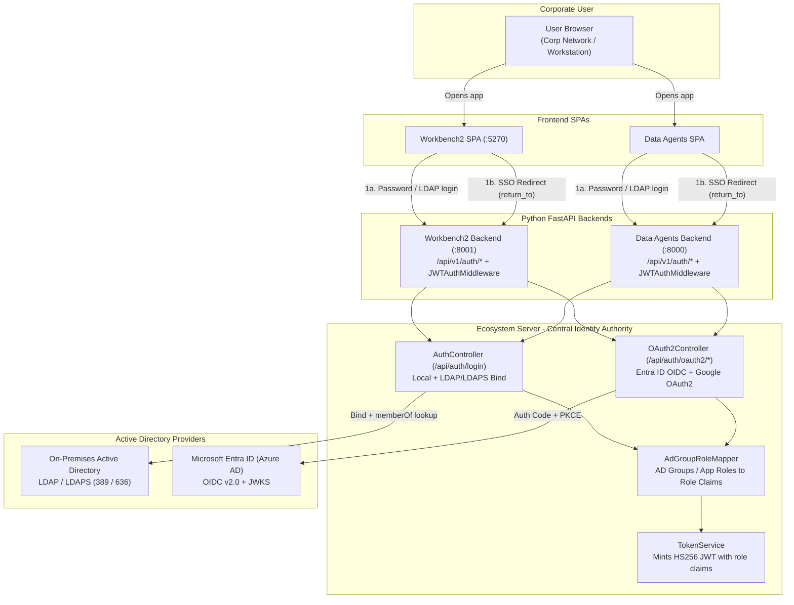

import { Callout } from 'nextra/components'

# Active Directory & Enterprise SSO

`ecosystem-server` is the central identity authority and HS256 JWT issuer across **Ecosystem Workbench2** (`:5270` / `:8001`), **Data Agents** (`:8000`), and **Ecosystem Modeling**. Both SPAs delegate login and SSO discovery to `ecosystem-server`, receive the canonical `{ token: { access_token, refresh_token, expires_in } }` session payload, and verify the token signature and `role` claims in `JWTAuthMiddleware`.

<Callout type="info" title="Zero-impact default when AD is not configured">
When `ENTRA_ENABLED` and `AD_LDAP_ENABLED` are unset or `false`, `GET /api/v1/auth/providers` returns `enabled: false`, the login screens render only the standard email/password form with zero extra redirects, and `POST /api/auth/login` authenticates against `user_master` unchanged.
</Callout>

## Architecture & Authentication Flow



## Supported Active Directory Modes

| Mode | Protocol | Entry Endpoint | When to Use |
| --- | --- | --- | --- |
| **Microsoft Entra ID (Azure AD)** | OIDC v2.0 Authorization Code + PKCE (`S256`) + RSA-SHA256 JWKS verification | `GET /api/v1/auth/oauth2/entra` → `GET /api/auth/oauth2/entra` | Cloud or hybrid Azure AD tenants with browser SSO and conditional access MFA |
| **On-Premises Active Directory** | JNDI LDAP / LDAPS (`389` / `636`) bind + `memberOf` lookup | `POST /api/v1/auth/login` → `POST /api/auth/login` | Direct domain credential verification (`user@domain.com` or `sAMAccountName`) inside a corporate network |
| **Corporate Network Auto-SSO** | Silent Entra OIDC (`prompt=none`) or Trusted Ingress Proxy (`X-Forwarded-User` / `X-Auth-Request-Email`) | Automatic on `/login` when `autoSso: true` | Zero-click sign-in when the user is already authenticated on their corporate workstation |

## 1. Microsoft Entra ID (Azure AD) Setup

### Step 1: Register or Configure the App in Azure Portal

1. Open **Azure Portal → Microsoft Entra ID → App registrations**.
2. Select your application (or click **+ New registration**).
3. Copy from **Overview**:
   - **Directory (tenant) ID** → `ENTRA_TENANT_ID`
   - **Application (client) ID** → `ENTRA_CLIENT_ID`
4. Open **Certificates & secrets → + New client secret**, create a secret, and copy the **Value** → `ENTRA_CLIENT_SECRET`.
5. Open **Authentication → + Add a platform → Web** and register the `ecosystem-server` callback URI:
   ```text
   http://localhost:3002/api/auth/oauth2/entra/callback
   ```
   *(In production, use your deployed `ecosystem-server` URL, e.g. `https://server.bank.internal/api/auth/oauth2/entra/callback`.)*
6. *(Optional — Group Sync)* Open **Token configuration → + Add groups claim** and select **Security groups** (or configure App Roles under **App roles**).

Or configure the Redirect URI and group claims via Azure CLI:

```bash
az ad app update \
  --id "$ENTRA_CLIENT_ID" \
  --web-redirect-uris "http://localhost:3002/api/auth/oauth2/entra/callback" \
  --set groupMembershipClaims="SecurityGroup"
```

### Step 2: Set Environment Variables on `ecosystem-server`

```bash
export OAUTH2_ENABLED="true"
export ENTRA_ENABLED="true"
export ENTRA_TENANT_ID="xxxxxxxx-xxxx-xxxx-xxxx-xxxxxxxxxxxx"
export ENTRA_CLIENT_ID="yyyyyyyy-yyyy-yyyy-yyyy-yyyyyyyyyyyy"
export ENTRA_CLIENT_SECRET="your-client-secret-value"
export ENTRA_BACKEND_CALLBACK="http://localhost:3002/api/auth/oauth2/entra/callback"
export ENTRA_ALLOWED_RETURN_ORIGINS="http://localhost:5270,http://127.0.0.1:5270,http://localhost:8000,http://localhost:5173"
```

## 2. On-Premises Active Directory (LDAP / LDAPS) Setup

When `AD_LDAP_ENABLED=true` and `AD_LDAP_URL` is set, `POST /api/auth/login` authenticates the user's domain credentials via LDAP/LDAPS bind, extracts `mail`, `displayName`, and `memberOf` group DNs, JIT-provisions the user in `user_master` if not yet present, and mints the internal JWT.

```bash
export AD_LDAP_ENABLED="true"
export AD_LDAP_URL="ldaps://dc01.corp.example.com:636"
export AD_LDAP_BASE_DN="DC=corp,DC=example,DC=com"
export AD_LDAP_USER_SEARCH_FILTER="(|(userPrincipalName={0})(mail={0})(sAMAccountName={0}))"
# Optional service account for searching user DN + memberOf prior to user bind:
export AD_LDAP_BIND_DN="CN=svc-ecosystem,OU=ServiceAccounts,DC=corp,DC=example,DC=com"
export AD_LDAP_BIND_PASSWORD="service-account-password"
# Allow break-glass local accounts in user_master when user is not in AD:
export AD_LDAP_FALLBACK_LOCAL="true"
```

## 3. Silent / Zero-Click Corporate Network Sign-In (Auto-SSO)

When an operator is on the corporate network and already signed into their Windows / macOS domain session or Microsoft 365:

- **Entra Seamless Auto-SSO (`ENTRA_AUTO_SSO=true`):**
  When an unauthenticated user opens Workbench2 or Data Agents, `LoginPage` queries `GET /api/v1/auth/providers`. When `autoSso: true` is returned, the browser automatically redirects through `/api/v1/auth/oauth2/entra?silent=true` (`prompt=none`), exchanges the corporate session for an Ecosystem JWT, and lands the user directly in the workspace without clicking a button.
  - Clicking **Sign Out** sets `sessionStorage['ecosystem_sso_logged_out'] = '1'` and navigates to `/login?nosso=1` so the user is never trapped in a redirect loop and can switch accounts.
- **Trusted Corporate Ingress Proxy (`AD_TRUSTED_HEADER_ENABLED=true`):**
  When fronted by an enterprise ingress proxy (Azure AD Application Proxy, `oauth2-proxy`, Keycloak, or Kerberos SPNEGO proxy) that sends `X-Ecosystem-Proxy-Secret` along with `X-Auth-Request-Email` / `X-Forwarded-User` and `X-Forwarded-Groups`, `GET /api/auth/oauth2/trusted` mints the JWT and redirects to `/oauth-callback#access_token=…`.

## 4. AD Group & App Role Mapping to Workbench RBAC

`AdGroupRoleMapper` maps Active Directory `memberOf` CNs, Entra Security Group IDs/names, and Entra App Roles into the JWT `role` array:

| Variable | Default | Purpose |
| --- | --- | --- |
| `AD_ADMIN_GROUPS` | `admin,ADMIN,Ecosystem-Admins,capricorn.admin,ecosystem.admin,Domain Admins` | Comma-separated AD group CNs, group Object IDs, or App Roles that grant `ADMIN` + `USER` |
| `AD_ROLE_MAP` | *(empty)* | Explicit mapping of AD groups to Workbench2 custom roles in `ecosystem_meta.roles` (e.g. `WB-Analysts=analyst,Marketing-Team=campaign_manager` or JSON `{"WB-Analysts":"analyst"}`) |
| `AD_PASSTHROUGH_ROLES` | `true` | Passes Entra App Role slugs through into JWT `role` claims so matching roles in **Administration → Roles** resolve automatically |

When the user lands in Workbench2 (`:5270`) or Data Agents (`:8000`), `AuthContext` normalizes the JWT `role` claims and `PermissionContext` resolves effective permissions via `POST /api/v1/roles/resolve`.

## 5. Complete `ecosystem-server` Environment Variables Reference

Add these environment variables to **`ecosystem-server`** (`docker-compose.yml`, Kubernetes `Secret` / `ConfigMap`, or `run_local.sh`). Workbench2 (`:8001`) and Data Agents (`:8000`) do **not** require separate Entra or LDAP credentials—they only need `ECOSYSTEM_SERVER` pointing to `ecosystem-server` (and `JWT_ACCESS_TOKEN_SECRET_KEY` when signature verification is enforced).

### Microsoft Entra ID (Azure AD) OIDC Variables

| Environment Variable | Spring Property | Default | Required for Entra? | Description |
| --- | --- | --- | --- | --- |
| `OAUTH2_ENABLED` | `oauth2.enabled` | `false` | Recommended (`true`) | Master OAuth2 switch (also auto-enabled when `ENTRA_ENABLED=true` and Entra credentials are set). |
| `ENTRA_ENABLED` | `oauth2.entra.enabled` | `false` | **Yes** (`true`) | Enables the `/api/auth/oauth2/entra` and `/api/auth/oauth2/entra/callback` OIDC endpoints and exposes `"entra"` in `/api/auth/oauth2/status`. |
| `ENTRA_TENANT_ID` | `oauth2.entra.tenant-id` | *(empty)* | **Yes** | Microsoft Entra **Directory (tenant) ID** UUID from the App Registration Overview blade. |
| `ENTRA_CLIENT_ID` | `oauth2.entra.client-id` | *(empty)* | **Yes** | Microsoft Entra **Application (client) ID** UUID from the App Registration Overview blade. |
| `ENTRA_CLIENT_SECRET` | `oauth2.entra.client-secret` | *(empty)* | **Yes** | Client secret **Value** (not the Secret ID) created under **Certificates & secrets**. |
| `ENTRA_BACKEND_CALLBACK` | `oauth2.entra.backend-callback-url` | `http://localhost:3002/api/auth/oauth2/entra/callback` | **Yes** (in prod) | Exact Web Redirect URI registered on the Entra App Registration. Must match the public URL of `ecosystem-server`. |
| `ENTRA_ALLOWED_RETURN_ORIGINS` | `oauth2.entra.allowed-return-origins` | `http://localhost:5270,http://127.0.0.1:5270,http://localhost:5173,http://localhost:5174,http://localhost:8000,http://localhost:3000` | **Yes** (in prod) | Comma-separated allowlist of frontend origins (`Workbench2`, `Data Agents`, `Modeling`) permitted in the `return_to` parameter. Prevents open-redirect attacks. |
| `ENTRA_AUTO_SSO` | `oauth2.entra.auto-sso` | `false` | Optional | When `true`, unauthenticated users opening Workbench2 or Data Agents on the corporate network are automatically redirected through silent Entra SSO (`prompt=none`). |
| `OAUTH2_FRONTEND_CALLBACK` | `oauth2.frontend-callback-url` | `http://localhost:5174/oauth-callback` | Optional | Fallback frontend callback URL used when a caller does not pass `return_to`. |

### On-Premises Active Directory (LDAP / LDAPS) Variables

| Environment Variable | Spring Property | Default | Required for LDAP? | Description |
| --- | --- | --- | --- | --- |
| `AD_LDAP_ENABLED` | `ad.ldap.enabled` | `false` | **Yes** (`true`) | Enables Active Directory LDAP/LDAPS bind inside `POST /api/auth/login` and exposes `"ldap"` in `/api/auth/oauth2/status`. |
| `AD_LDAP_URL` | `ad.ldap.url` | *(empty)* | **Yes** | LDAP or LDAPS server URL (e.g. `ldaps://dc01.corp.example.com:636` or `ldap://dc01.corp.example.com:389`). |
| `AD_LDAP_BASE_DN` | `ad.ldap.base-dn` | *(empty)* | **Yes** | Base Distinguished Name for user searches (e.g. `DC=corp,DC=example,DC=com`). |
| `AD_LDAP_USER_SEARCH_FILTER` | `ad.ldap.user-search-filter` | `(|(userPrincipalName={0})(mail={0})(sAMAccountName={0}))` | Optional | LDAP filter used to match the login input against `userPrincipalName`, `mail`, or `sAMAccountName`. |
| `AD_LDAP_BIND_DN` | `ad.ldap.bind-dn` | *(empty)* | Optional | Service account DN used to search for the user's entry and `memberOf` groups before binding as the user. If empty, direct user bind is used. |
| `AD_LDAP_BIND_PASSWORD` | `ad.ldap.bind-password` | *(empty)* | Optional | Password for `AD_LDAP_BIND_DN`. |
| `AD_LDAP_DEFAULT_DOMAIN` | `ad.ldap.default-domain` | *(empty)* | Optional | Default domain appended when a user signs in with a short `sAMAccountName` (e.g. `jdoe` → `jdoe@corp.example.com`). |
| `AD_LDAP_FALLBACK_LOCAL` | `ad.ldap.fallback-local` | `true` | Optional | When `true`, if a user is not found in Active Directory, `ecosystem-server` falls back to local `user_master` authentication (allowing break-glass admin accounts such as `admin@ecosystem.ai`). Set to `false` to enforce strict AD-only login. |
| `AD_LDAP_CONNECT_TIMEOUT_MS` | `ad.ldap.connect-timeout-ms` | `5000` | Optional | LDAP socket connection timeout in milliseconds. |
| `AD_LDAP_READ_TIMEOUT_MS` | `ad.ldap.read-timeout-ms` | `5000` | Optional | LDAP search/read timeout in milliseconds. |

### Group-to-Role Mapping & Trusted Corporate Proxy Variables

| Environment Variable | Spring Property | Default | Description |
| --- | --- | --- | --- |
| `AD_ADMIN_GROUPS` | `ad.roles.admin-groups` | `admin,ADMIN,Ecosystem-Admins,capricorn.admin,ecosystem.admin,Domain Admins` | Comma-separated AD group CNs, Entra Group Object IDs, or Entra App Roles that grant `ADMIN` + `USER` in the issued JWT. |
| `AD_ROLE_MAP` | `ad.roles.map` | *(empty)* | Comma/semicolon-separated `ADGroup=workbenchRole` pairs or JSON object mapping AD groups to Workbench2 roles in `ecosystem_meta.roles`. |
| `AD_PASSTHROUGH_ROLES` | `ad.roles.passthrough` | `true` | Automatically includes Entra App Role values in the JWT `role` array. |
| `AD_TRUSTED_HEADER_ENABLED` | `ad.trusted-header.enabled` | `false` | Enables `GET /api/auth/oauth2/trusted` for corporate ingress proxies (Azure AD App Proxy, `oauth2-proxy`, Keycloak, Kerberos SPNEGO). |
| `AD_TRUSTED_PROXY_SECRET` | `ad.trusted-header.proxy-secret` | *(empty)* | Shared secret verified against the `X-Ecosystem-Proxy-Secret` request header before trusting `X-Auth-Request-Email` / `X-Forwarded-User`. |

### Downstream Service Variables (`ecosystem-workbench2` & `ecosystem-data-agents`)

| Environment Variable | Service | Purpose |
| --- | --- | --- |
| `ECOSYSTEM_SERVER` | Workbench2 (`:8001`) & Data Agents (`:8000`) | Base URL of `ecosystem-server` (e.g. `http://localhost:3002` or `http://ecosystem-server:3001`) used by `/api/v1/auth/providers`, `/api/v1/auth/oauth2/{provider}`, and `/api/v1/auth/login`. |
| `JWT_ACCESS_TOKEN_SECRET_KEY` | Workbench2 (`:8001`) & Data Agents (`:8000`) | Raw secret matching `jwt.accessTokenSecretKey` on `ecosystem-server` for HS256 JWT signature verification. |
| `BANK_DEPLOY_PROFILE` | Workbench2 (`:8001`) | When `true`, enforces mandatory HS256 JWT signature verification, `CHANNEL_ENCRYPTION_KEY`, and strict CORS origin allowlisting. |

### Ready-to-Use `.env` / Docker Compose Snippet for `ecosystem-server`

```dotenv
# --- Microsoft Entra ID (Azure AD) OIDC ---
OAUTH2_ENABLED=true
ENTRA_ENABLED=true
ENTRA_TENANT_ID=bee76bcd-c24a-4367-9feb-0b35199d8104
ENTRA_CLIENT_ID=7208ec8d-fd46-4900-ad36-dc8d54955e3e
ENTRA_CLIENT_SECRET=<your-entra-client-secret-value>
ENTRA_BACKEND_CALLBACK=http://localhost:3002/api/auth/oauth2/entra/callback
ENTRA_ALLOWED_RETURN_ORIGINS=http://localhost:5270,http://127.0.0.1:5270,http://localhost:8000,http://localhost:5173
ENTRA_AUTO_SSO=false

# --- On-Premises Active Directory (LDAP / LDAPS) (Optional) ---
AD_LDAP_ENABLED=false
AD_LDAP_URL=ldaps://ad.corp.example.com:636
AD_LDAP_BASE_DN=DC=corp,DC=example,DC=com
AD_LDAP_BIND_DN=
AD_LDAP_BIND_PASSWORD=
AD_LDAP_FALLBACK_LOCAL=true

# --- AD Group -> Ecosystem Role Mapping ---
AD_ADMIN_GROUPS="admin,ADMIN,Ecosystem-Admins,capricorn.admin,ecosystem.admin,Domain Admins"
AD_ROLE_MAP="WB-Analysts=analyst,Marketing-Team=campaign_manager"
```

## Verification Endpoints

Check active provider configuration from either backend or directly against `ecosystem-server`:

```bash
# Via Workbench2 or Data Agents backend proxy:
curl http://localhost:8001/api/v1/auth/providers

# Directly on ecosystem-server:
curl http://localhost:3002/api/auth/oauth2/status
```

Response when Entra ID is enabled:

```json
{
  "enabled": true,
  "configured": true,
  "providers": ["entra", "google"],
  "entraEnabled": true,
  "ldapEnabled": false,
  "autoSso": false,
  "autoSsoProvider": ""
}
```
