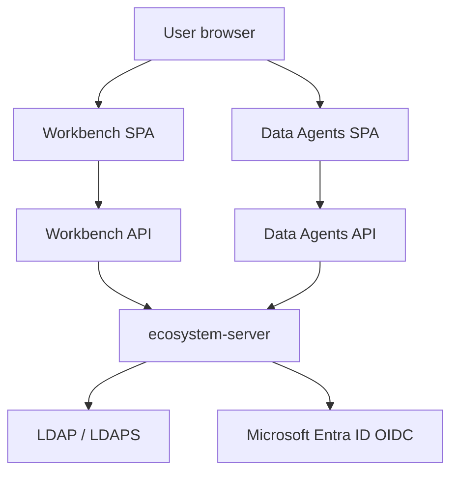

import { Callout } from 'nextra/components'

# Active Directory & Enterprise SSO

`ecosystem-server` is the central identity service for **Ecosystem Workbench** and **Data Agents**. Both SPAs use the same login and SSO discovery endpoints on `ecosystem-server`, then store the returned session token for API calls.

| Product | Typical local ports |
| --- | --- |
| Workbench UI | `:5270` |
| Workbench API | `:8001` |
| Data Agents UI | `:54325` |
| Data Agents API | `:54324` |
| `ecosystem-server` | `:3002` (local default; use your deployed URL in production) |

<Callout type="info" title="Default when AD is not configured">
When `ENTRA_ENABLED` and `AD_LDAP_ENABLED` are unset or `false`, provider discovery reports SSO disabled, login screens show email/password only, and `POST /api/auth/login` authenticates against local `user_master` as before.
</Callout>

## Architecture (high level)



Frontends call their backend `/api/v1/auth/*` routes; backends proxy to `ecosystem-server` for login, OAuth redirects, and token issuance.

## Supported modes

| Mode | Protocol | Entry (via backend proxy) | When to use |
| --- | --- | --- | --- |
| **Microsoft Entra ID** | OIDC v2 authorization code + PKCE | `GET /api/v1/auth/oauth2/entra` | Cloud or hybrid Azure AD with browser SSO |
| **On-premises AD** | LDAP / LDAPS bind + group lookup | `POST /api/v1/auth/login` | Domain credentials on the corporate network |
| **Corporate auto-SSO** | Silent Entra OIDC or trusted ingress headers | Automatic on `/login` when enabled | Zero-click sign-in when the user already has a corporate session |

## 1. Microsoft Entra ID (Azure AD)

### App registration

1. **Azure Portal → Microsoft Entra ID → App registrations** → your app (or **New registration**).
2. From **Overview**, copy **Directory (tenant) ID** → `ENTRA_TENANT_ID` and **Application (client) ID** → `ENTRA_CLIENT_ID`.
3. **Certificates & secrets** → create a client secret → `ENTRA_CLIENT_SECRET`.
4. **Authentication → Web** → register the `ecosystem-server` callback, for example:
   ```text
   http://localhost:3002/api/auth/oauth2/entra/callback
   ```
   In production use your public server URL, e.g. `https://server.example.com/api/auth/oauth2/entra/callback`.
5. *(Optional)* **Token configuration → Add groups claim** (security groups or app roles).

```bash
az ad app update \
  --id "$ENTRA_CLIENT_ID" \
  --web-redirect-uris "http://localhost:3002/api/auth/oauth2/entra/callback" \
  --set groupMembershipClaims="SecurityGroup"
```

### Environment variables (`ecosystem-server`)

```bash
export OAUTH2_ENABLED="true"
export ENTRA_ENABLED="true"
export ENTRA_TENANT_ID="<your-tenant-id>"
export ENTRA_CLIENT_ID="<your-client-id>"
export ENTRA_CLIENT_SECRET="<your-client-secret>"
export ENTRA_BACKEND_CALLBACK="http://localhost:3002/api/auth/oauth2/entra/callback"
export ENTRA_ALLOWED_RETURN_ORIGINS="http://localhost:5270,http://127.0.0.1:5270,http://localhost:54325,http://localhost:5173"
```

## 2. On-premises Active Directory (LDAP / LDAPS)

When `AD_LDAP_ENABLED=true`, `POST /api/auth/login` binds with the user's domain credentials, reads profile and group membership, provisions the user in `user_master` if needed, and returns a session token.

```bash
export AD_LDAP_ENABLED="true"
export AD_LDAP_URL="ldaps://dc01.corp.example.com:636"
export AD_LDAP_BASE_DN="DC=corp,DC=example,DC=com"
export AD_LDAP_USER_SEARCH_FILTER="(|(userPrincipalName={0})(mail={0})(sAMAccountName={0}))"
export AD_LDAP_BIND_DN="CN=svc-ecosystem,OU=ServiceAccounts,DC=corp,DC=example,DC=com"
export AD_LDAP_BIND_PASSWORD="<service-account-password>"
```

<Callout type="warning" title="Production LDAP">
Set `AD_LDAP_FALLBACK_LOCAL=false` so only directory users can sign in. Configure a dedicated **emergency break-glass administrator** in `user_master` (strong password, MFA where possible) and restrict who knows that account. Do not rely on local-password fallback in production unless you explicitly accept that risk.
</Callout>

## 3. Silent / zero-click sign-in (auto-SSO)

- **`ENTRA_AUTO_SSO=true`:** Unauthenticated visits to Workbench or Data Agents can redirect through silent Entra OIDC (`prompt=none`) when the corporate session is already present.
- **Trusted ingress proxy (`AD_TRUSTED_HEADER_ENABLED=true`):** When fronted by an enterprise proxy that forwards identity headers (email and optional groups) and a shared proxy secret you configure on the server, `GET /api/auth/oauth2/trusted` can mint a session and redirect back to the SPA.

Sign-out should land on `/login?nosso=1` so users are not stuck in an SSO loop when switching accounts.

## 4. AD groups and Workbench roles

Directory groups and Entra app roles map into JWT **role** claims used by Workbench and Data Agents RBAC.

| Variable | Example default | Purpose |
| --- | --- | --- |
| `AD_ADMIN_GROUPS` | `admin,ADMIN,Ecosystem-Admins,ecosystem.admin,Domain Admins` | Groups that grant administrator access |
| `AD_ROLE_MAP` | *(empty)* | Map AD group names to custom Workbench roles, e.g. `WB-Analysts=analyst` or JSON `{"WB-Analysts":"analyst"}` |
| `AD_PASSTHROUGH_ROLES` | `true` | Include Entra app role values in JWT roles when they match roles defined under **Administration → Roles** |

Resolve effective permissions in the product UI via role administration after SSO.

## 5. Environment variable reference (`ecosystem-server`)

Workbench (`:8001`) and Data Agents (`:54324`) do **not** need separate Entra or LDAP secrets. Point both at `ecosystem-server` with `ECOSYSTEM_SERVER` (see downstream table).

### Entra OIDC

| Environment variable | Required for Entra | Description |
| --- | --- | --- |
| `OAUTH2_ENABLED` | Recommended | Master OAuth2 switch |
| `ENTRA_ENABLED` | **Yes** | Enables Entra authorize/callback endpoints |
| `ENTRA_TENANT_ID` | **Yes** | Tenant (directory) UUID |
| `ENTRA_CLIENT_ID` | **Yes** | Application (client) UUID |
| `ENTRA_CLIENT_SECRET` | **Yes** | Client secret value |
| `ENTRA_BACKEND_CALLBACK` | **Yes** (prod) | Must match the redirect URI registered in Entra |
| `ENTRA_ALLOWED_RETURN_ORIGINS` | **Yes** (prod) | Comma-separated SPA origins allowed in `return_to` (open-redirect protection) |
| `ENTRA_AUTO_SSO` | Optional | Enable silent corporate SSO |
| `OAUTH2_FRONTEND_CALLBACK` | Optional | Fallback SPA callback when `return_to` is omitted |

### LDAP / LDAPS

| Environment variable | Required for LDAP | Description |
| --- | --- | --- |
| `AD_LDAP_ENABLED` | **Yes** | Enables LDAP bind on login |
| `AD_LDAP_URL` | **Yes** | e.g. `ldaps://dc01.corp.example.com:636` |
| `AD_LDAP_BASE_DN` | **Yes** | Search base DN |
| `AD_LDAP_USER_SEARCH_FILTER` | Optional | LDAP filter matching login to `userPrincipalName`, `mail`, or `sAMAccountName`. Default is the same OR-filter as in the LDAP setup example above (`{0}` is the login string). |
| `AD_LDAP_BIND_DN` | Optional | Service account for search before user bind |
| `AD_LDAP_BIND_PASSWORD` | Optional | Password for bind DN |
| `AD_LDAP_DEFAULT_DOMAIN` | Optional | Appended when users sign in with short `sAMAccountName` |
| `AD_LDAP_FALLBACK_LOCAL` | Optional | If `true`, unknown LDAP users may fall back to local `user_master`. Prefer `false` in production |
| `AD_LDAP_CONNECT_TIMEOUT_MS` | Optional | Connection timeout (default `5000`) |
| `AD_LDAP_READ_TIMEOUT_MS` | Optional | Read timeout (default `5000`) |

### Group mapping and trusted proxy

| Environment variable | Description |
| --- | --- |
| `AD_ADMIN_GROUPS` | Groups granting admin roles (comma-separated) |
| `AD_ROLE_MAP` | Explicit AD group → Workbench role map |
| `AD_PASSTHROUGH_ROLES` | Pass Entra app roles into JWT |
| `AD_TRUSTED_HEADER_ENABLED` | Enable trusted ingress SSO |
| `AD_TRUSTED_PROXY_SECRET` | Shared secret your proxy sends; must match server config |

### Downstream services

| Environment variable | Service | Purpose |
| --- | --- | --- |
| `ECOSYSTEM_SERVER` | Workbench & Data Agents | Base URL of `ecosystem-server` for `/api/v1/auth/providers`, OAuth redirects, and login proxy |

Follow your deployment guide for any JWT signature verification settings required between server and backends.

### Example `.env` snippet (`ecosystem-server`)

```dotenv
OAUTH2_ENABLED=true
ENTRA_ENABLED=true
ENTRA_TENANT_ID=<your-tenant-id>
ENTRA_CLIENT_ID=<your-client-id>
ENTRA_CLIENT_SECRET=<your-client-secret>
ENTRA_BACKEND_CALLBACK=http://localhost:3002/api/auth/oauth2/entra/callback
ENTRA_ALLOWED_RETURN_ORIGINS=http://localhost:5270,http://127.0.0.1:5270,http://localhost:54325,http://localhost:5173
ENTRA_AUTO_SSO=false

AD_LDAP_ENABLED=false
AD_LDAP_FALLBACK_LOCAL=false

AD_ADMIN_GROUPS="admin,ADMIN,Ecosystem-Admins,ecosystem.admin,Domain Admins"
AD_ROLE_MAP="WB-Analysts=analyst,Marketing-Team=campaign_manager"
```

## Verification

```bash
# Via Workbench or Data Agents backend:
curl http://localhost:8001/api/v1/auth/providers
curl http://localhost:54324/api/v1/auth/providers

# Directly on ecosystem-server:
curl http://localhost:3002/api/auth/oauth2/status
```

When Entra is enabled, status includes `"entra"` among providers and reports whether LDAP and auto-SSO are active.
