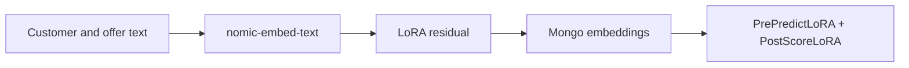

import { Callout } from 'nextra/components'

# LoRA Recommender Module

## Overview

The **LoRA Recommender** adapts frozen text embeddings (default
`nomic-embed-text`) with a small low-rank residual, then ranks offers by
cosine or dot-product similarity — the same live scoring shape as Two-Tower.

It is a **sibling** of [Two-Tower](/docs/modules/two_tower). Two-Tower
(`predictor.model.type=similarity`) is unchanged.

## Where it fits

| Stage | Component |
|-------|-----------|
| Train / export | Workbench **Solutions → LoRA Recommender** (`/lora`) + notebooks PyTorch sidecar |
| Live score | ecosystem-runtime `predictor.model.type=lora` |
| Plugins | `PrePredictLoRA`, `PostScoreLoRA` |

## Closed loop

When collecting feedback: `POST /invocations`, then `POST /response` (singular)
with that row’s `uuid` + `offer_name`. `params` is a JSON string.

<Callout type="info">
  Chat models such as qwen3.8 are not used for ranking. The embeddings path
  stays on `nomic-embed-text` (or your configured `EMBEDDING_SERVER_MODEL`).
</Callout>
