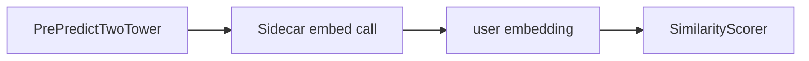

import { Callout } from 'nextra/components'

# PyTorch Serving

This page covers how **PyTorch** powers two-tower (and general) scoring in
ecosystem.Ai. The runtime stays lightweight: PyTorch runs in a **notebooks
sidecar**, and the runtime talks to it over HTTP when you opt in to live
embeddings.

In Workbench, PyTorch is an alternative training engine for the `/two-tower`
module. It should produce the same run metadata and Mongo embedding export shape
as the H2O engine, so downstream deployment remains engine-agnostic.

## Engine options in the runtime

| Engine | Status | Two-tower suitability |
| --- | --- | --- |
| `api:` HTTP serving | **Production** | **Recommended** — PyTorch in a sidecar |
| DJL + TorchScript (in-JVM) | Scaffolding only | Possible later; single model slot |
| ONNX Runtime | Not present | Would be a new integration |
| Precomputed embeddings | Pattern in use | **Best latency** for items |

The recommended path is **`api:` HTTP serving**: the runtime calls the sidecar over
HTTP and keeps heavy ML dependencies out of the JVM.

## Two `api:pytorch` configuration paths

### 1. General PyTorch model scoring

Register an HTTP-served model directly in `mojo.key`:

```properties
mojo.key=api:pytorch:http://<notebooks-host>:8010:<model_id>
```

The runtime sends feature instances to the sidecar and normalizes the response
into the canonical score shape.

### 2. Two-tower user-tower embedding

For two-tower, the user vector can be computed **live** by the sidecar when no
precomputed vector exists:

```properties
predictor.model.type=similarity
predictor.twotower.user.embed=pytorch:http://<notebooks-host>:8010:<model_id>
```

**PrePredictTwoTower** requests a user embedding from the sidecar when needed.
Item vectors stay precomputed, so there is **one sidecar call per request**, not
one per offer. Timeouts are bounded so a hung sidecar cannot block runtime
request threads indefinitely.



## Training and export in Workbench

1. On **`/two-tower`**, set `engine` to **`pytorch_notebooks`** on the saved
   configuration.
2. Run **Train** (same flow as `POST /public/v1/two-tower/train`).
3. Run **Concept test**, then **Export embeddings for runtime** so MongoDB holds
   normalized user and item vectors for **PrePredictTwoTower**.

For production, prefer exported Mongo embeddings over live sidecar calls for every
customer. Use `predictor.twotower.user.embed` only when user vectors must be
computed from fresh request features.

<Callout type="warning" title="pytorch_mlrun is reserved">
  The `pytorch_mlrun` engine value is rejected at request validation (HTTP
  422). Use **`pytorch_notebooks`** for PyTorch two-tower training in Workbench.
</Callout>

Workbench algorithm and public API request shapes are in the
[API Reference](/docs/modules/two_tower/api). Runtime scoring properties are in
[Real-Time Scoring](/docs/modules/two_tower/runtime).
