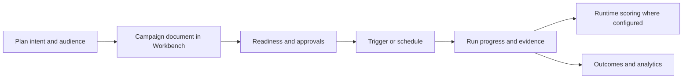

import { Callout } from 'nextra/components'

# Campaign delivery

Workbench manages **delivery campaigns** (email, SMS, WhatsApp, schedules, and agent-assisted outreach). That layer is separate from **Runtime scoring campaigns** (`campaign` / `subcampaign` on `POST /invocations`).

| Layer | What it is | Typical API |
| --- | --- | --- |
| **Delivery campaign** | Business overlay: audience, channels, content, schedules, runs | Workbench `/api/v1/campaigns` and [Public API — Campaigns](/docs/configuration/workbench_apis/public#campaigns) |
| **Scoring deployment** | Predictor pushed to Runtime | `POST /invocations` → `POST /response` on the Runtime host |

Runtime `channel` values such as `app`, `web`, or `api` describe the scoring context. Delivery **channel catalog** entries (email providers, WhatsApp, …) live on the Workbench campaign document.

## Operator surfaces

| Surface | Use for |
| --- | --- |
| **Campaign manager** (Intelligent Sales) | Edit campaign documents, channels, schedules, and triggers |
| **Custom Forms** | Capture structured inputs linked to campaign workflows |
| **Data Management & Campaign** | Join audience data with campaign entities |
| **Time Process Campaign** | Time-based process steps on a campaign graph |
| **Campaign Management service** | Agentic campaign ops when `ecosystem-campaign-management` is deployed — see [Claude Agent — Campaign Management](/docs/workers/agent_framework/claude-agent#campaign-management) |
| **Campaign Outreach Agent** | Build/configure/run outreach via MCP tools (`sample_run`, `test_target_email`) — [Workbench MCP](/docs/configuration/workbench_apis/mcp) |

## Campaign process workflow

A typical end-to-end **campaign process** (business overlay + technical execution) looks like this:

1. **Plan** audience, content, and channels on the campaign document (or with the Campaign Agent / Outreach Agent where enabled).
2. **Wire** delivery channels — `GET /public/v1/campaigns/channel-catalog`, then set selection with `PUT …/channel-selection` ([Public API](/docs/configuration/workbench_apis/public#campaigns)).
3. **Validate before live send** — prefer a **dry or sample run** first:
   - Outreach MCP: `run_outreach_campaign` with `sample_run` and optional `test_target_email` ([MCP tool table](/docs/configuration/workbench_apis/mcp)).
   - Inspect **`GET /public/v1/campaigns/runs/{run_id}/progress`** before promoting to production traffic.
4. **Trigger** with `POST /public/v1/campaigns/{campaign_id}/trigger` or arm schedules via `POST …/schedules/sync`.
5. **Monitor** runs (`GET …/runs`, `GET …/runs/{run_id}`) and **stop** if needed (`POST …/runs/{run_id}/stop`).
6. Where a deployment is linked, closed-loop **scoring** still uses Runtime [`POST /invocations`](/docs/quick_start) then [`POST /response`](/docs/quick_start).

<Callout type="warning" title="Delivery vs scoring">
Changing delivery schedules does not replace pushing or testing a **deployment**. Use [Deployment Test](/docs/configuration/deployment/test) or [Runtime Testing](/docs/runtime/testing) for predictor behaviour.
</Callout>

## HTTP API summary

Full tables: [Public API — Campaigns](/docs/configuration/workbench_apis/public#campaigns). Private `/api/v1/campaigns` mirrors campaign CRUD, `_generate` helpers, and operator triggers ([Private APIs](/docs/configuration/workbench_apis/private)).

Entity collection name on the public gateway: **`campaigns`** (see [Entity collections](/docs/configuration/workbench_apis/public#entity-collections)).

## Related

- [Claude Agent](/docs/workers/agent_framework/claude-agent) — Campaign Management profile and CM MCP bridge
- [Deployment Test](/docs/configuration/deployment/test) — closed-loop test for a pushed deployment
- [Simulations](/docs/configuration/simulations) — volume traffic against a deployment
- [Ontology for agents](/docs/ontology/agents) — grounding agent tools before API calls
